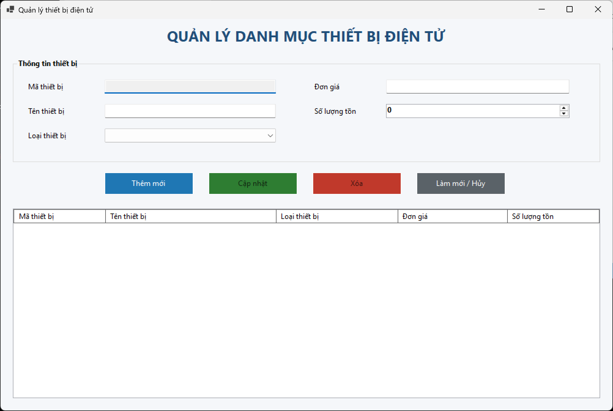
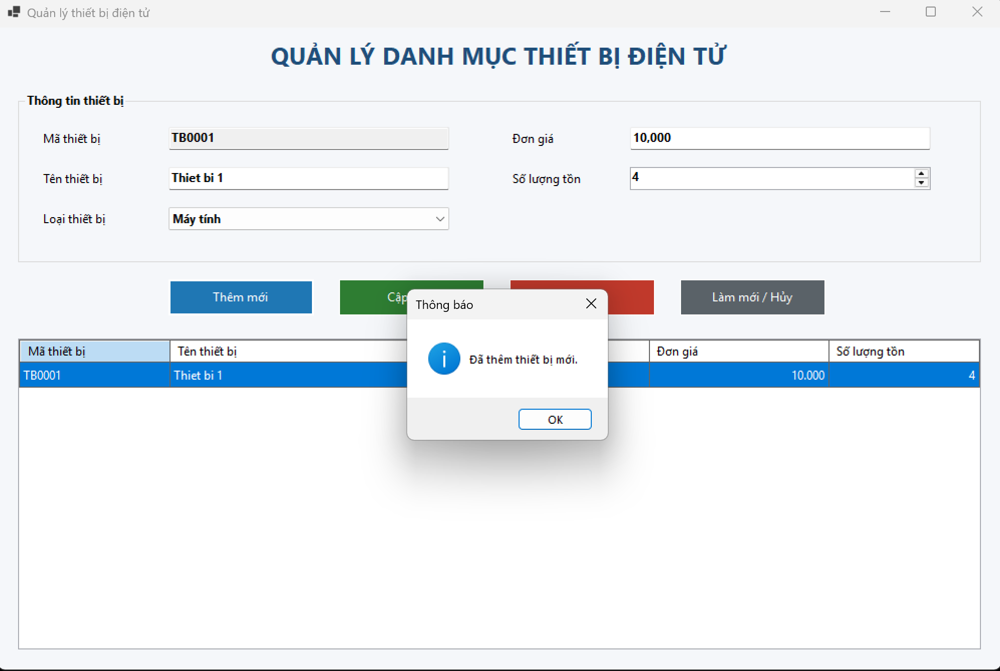
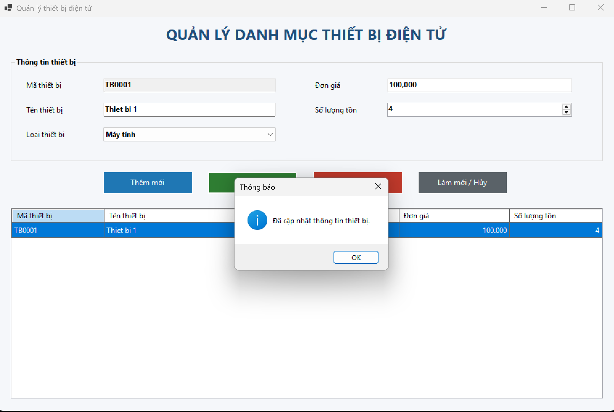
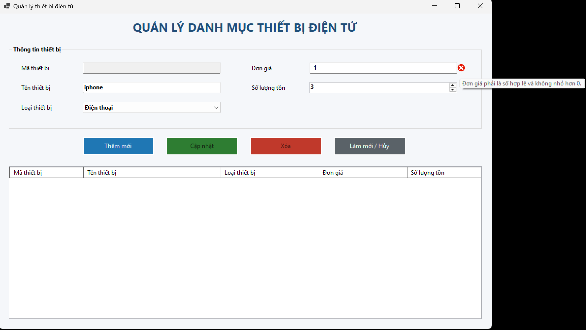

Markdown
# BÁO CÁO BÀI TẬP / ĐỒ ÁN

## THÔNG TIN SINH VIÊN
- **Họ và tên:** Nguyễn Thành Nam
- **Mã số sinh viên:** 24810310230
- **Lớp:** D19CNPM3
- **Tên môn học:** Lập trình C# / Windows Forms
- **Tên bài tập:** Bài 01

---

## KẾT QUẢ THỰC HÀNH

### 1. Ảnh màn hình giao diện chính

### 2. Ảnh màn hình chức năng thực thi / kết quả

#### 2.1. Chức năng thêm thiết bị

#### 2.2. Chức năng cập nhật thông tin

### 3. Ảnh màn hình kiểm tra lỗi (Validation)

