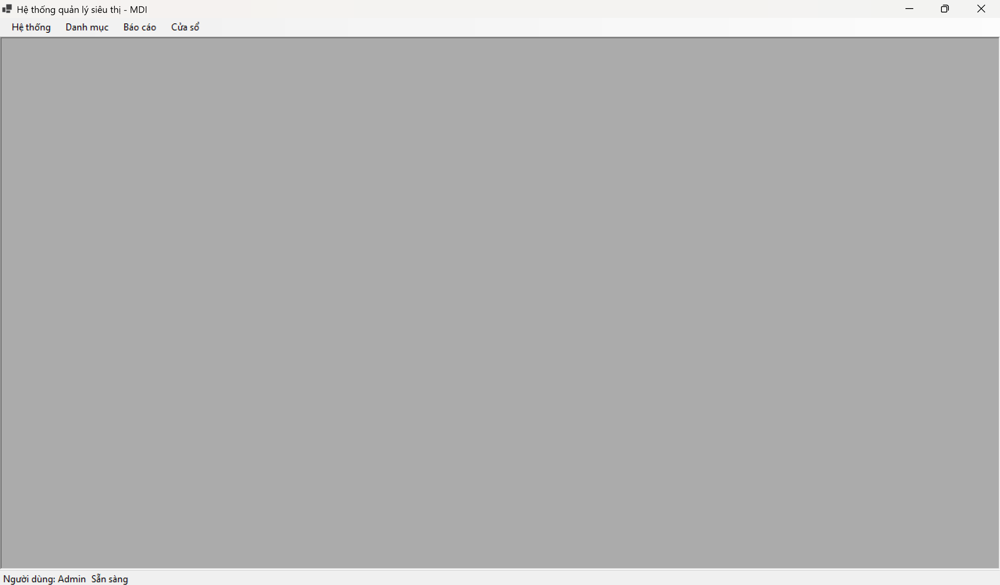
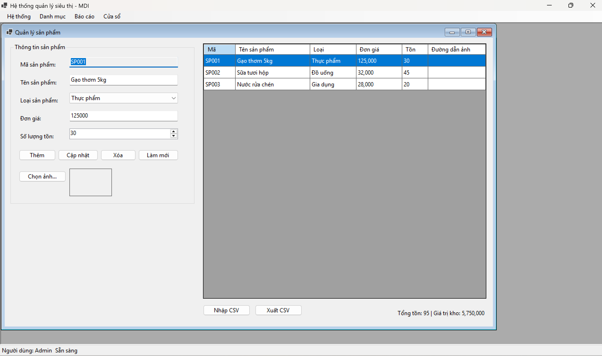
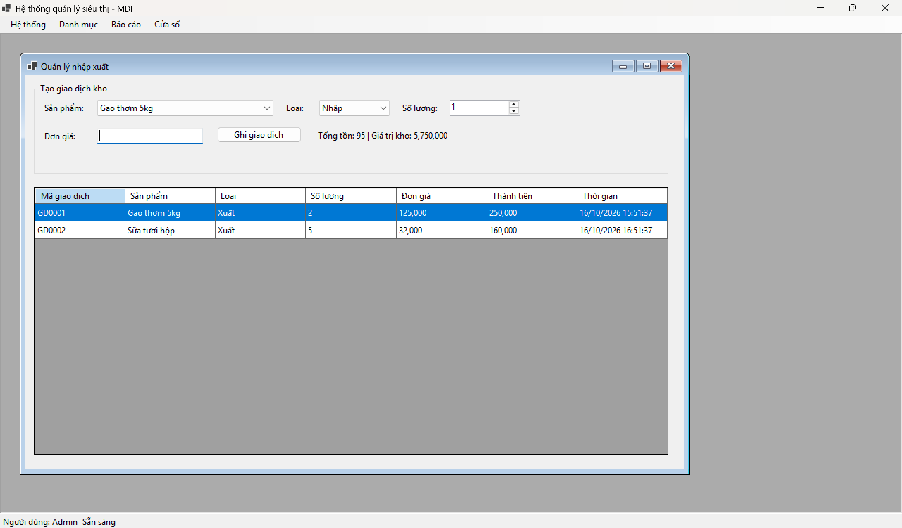
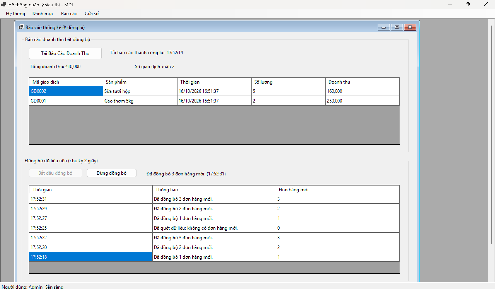

Markdown
# BÁO CÁO BÀI TẬP / ĐỒ ÁN

## THÔNG TIN SINH VIÊN
- **Họ và tên:** Nguyễn Thành Nam
- **Mã số sinh viên:** 24810310230
- **Lớp:** D19CNPM3
- **Tên môn học:** Lập trình C# / Windows Forms
- **Tên bài tập:** Bài 03

---

## KẾT QUẢ THỰC HÀNH

### 1. Giao diện chính

### 2. Chức năng quản lý sản phẩm

### 3. Chức năng quản lý nhập xuất

### 4. Chức năng báo cáo thống kê và đồng bộ

